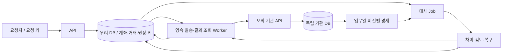

# 거래 원장 아키텍처와 장애 복구 설계

목표 사례는 [[금융 백엔드 포트폴리오 5장 원고]]의 개인 1~4장이다. 구현 완료를 뜻하지 않는다. 이 파일은 구조·계약, [[2026-10-07-Q-representative-article-detailed-plan]]은 실험·증거를 담당한다. 에이전트는 사용자가 제공하는 실제 코드·설정·테스트로 현재 상태를 확인한다. 협업은 별도 주제다.

## 범위·구조

내부 무수수료 원화 이체가 기반이다. 모의 외부 거래·예약·발송 작업은 3장/대표 글의 확장이고 실제 금융망 계약은 아니다.

Q→DB는 검증된 기존 거래 처리/조정 경로이며 원장 임의 수정이 아니다. 모의 명세는 기관 자체 기록에서 생성한다. API·Worker·Job은 책임 구분이며 마이크로서비스를 강제하지 않는다. 발송 작업을 DB에 남겨 재시작 후 찾는다. 목표 사양과 실제 실험 환경은 구분하며 Standby·무손실 전환은 네 사례의 필수 범위가 아니다.

## 개인 사례별 설계

| 사례 | 필수 경계·규칙 | 미결 선택 |
|---|---|---|
| 1 동시성 | 잔액 규칙·금액 보존, 두 계좌 접근 순서, 충돌/교착/잔액 부족 구분 | 조건부 UPDATE·낙관/비관 잠금의 정확성·비용 비교 |
| 2 원자성 | 출금·입금·거래·원장 한 로컬 트랜잭션. 예외 전파·catch·rollback 규칙 확인 | 실제 프레임워크 버전·트랜잭션 경계 |
| 3 멱등성 | 요청자/업무 범위+키 유일성, 내용 비교, 같은 요청은 같은 거래, 다른 내용 거절 | 키·결과 보관 기간과 만료 후 정책 |
| 4 대사/복구 | ID·금액·통화·상태 비교, 명세 완전성·버전, 중단 재개·중복 처리 방지 | SQL·인덱스·처리 단위·체크포인트 |

3장 내부 이체의 커밋 후 응답 유실은 저장 결과 조회로 처리한다. 외부 거래는 로컬 rollback으로 기관 효과를 취소할 수 없다.

## 외부 확장의 트랜잭션·상태

1. 로컬 TX: 키 검증·거래 생성·자금 예약·발송 의도 저장.
2. TX 밖: 안정적인 기관 키로 HTTP 전송·조회.
3. 로컬 TX: 조건부 최종 상태 전이·예약 확정/해제·원장 반영. Worker·대사가 경합해도 중복 반영 금지.

발송 전 접수→처리 중/미확정→성공 또는 확정 거절. 검토 필요는 별도 표시한다.

| 증거 | 상태·금액 판단 |
|---|---|
| 같은 거래 ID·금액·통화의 최종 성공 | 성공 확정·예약 소진 |
| 이후 처리되지 않음을 보장하는 최종 거절 | 거절 확정·예약 해제 |
| 타임아웃·일시 오류·조회 부재·마감 경과 | 미확정 유지·조회/검토 |
| 최종성과 버전이 검증된 명세 결과 | 기존 확정 경로로 복구·재대사 |
| 금액 차이·모순된 최종 결과 | 검토 필요·자동 금액 변경 금지 |

구현 전 기관의 키 보장/보관 기간, 조회 부재 의미, 최종 거절의 불가역성, 명세 수정 규칙을 정한다. Worker 작업 확보·임대 만료·재시도 간격/한도·장기 미확정 검토 기준도 명시한다. ‘없음’을 거절로 취급하거나 새 키로 무조건 재전송하지 않는다.

## 데이터·대사·복구 계약

최소 책임: accounts(사용 가능/예약), transfers(ID·키·금액·통화·상태/버전), ledger_entries(불변 기록), request_keys(내용·거래 연결), dispatch_jobs(시도·임대·다음 시각), reconciliation_runs/differences(버전·체크포인트·차이·조정 이력). 이름은 실제 스키마에 맞춘다.

명세는 ID/revision·업무일/시간대·생성 시각/마감·거래/기관 ID·금액/통화/상태·건수/합계/체크섬을 정의한다. 업무일·수신일·결제일을 구분하고 공식 지급망 규칙과 모의 마감 정책을 분리한다.

복구: 차이 발견→기관 조회·명세 검증→분류→가능한 결과 확정/승인된 조정 또는 검토→재대사→이력·종료 시각. 수정 명세는 기존 결과를 지우지 않고 버전별 추적한다. 대사 일치·정산 집계·실제 기관 간 결제 완료는 다른 의미다.

관측 ID는 요청·거래·기관·명세·작업을 연결한다. 미확정 건수/체류시간·작업 backlog·차이·복구시간을 남긴다. 설계 선택은 이유·대안·비용을 기록하고 실측 전에는 목표로 유지한다.
