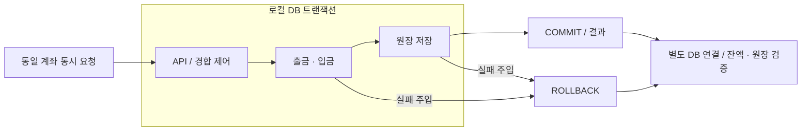
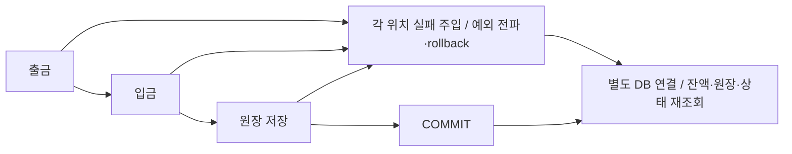
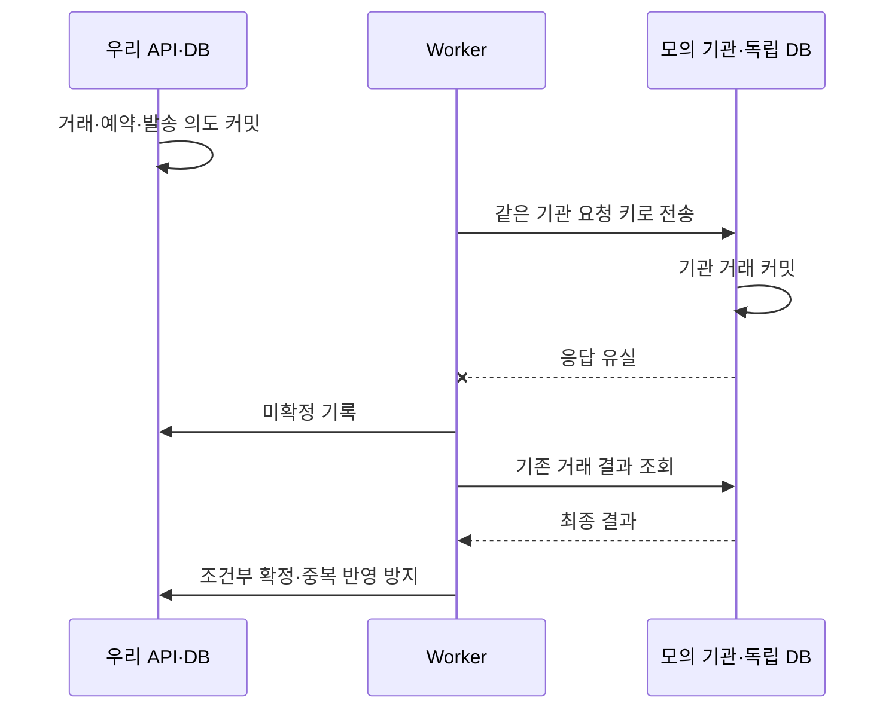
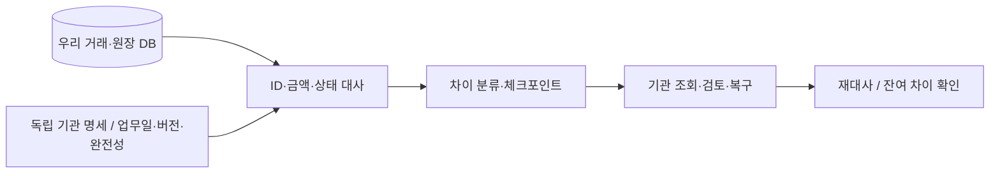

# 금융 백엔드 포트폴리오 — 개인 4개·협업 1개 문제 해결 블록

> 개발·학습을 위한 이상형 편집 원고다. 모든 사례는 목표이며 실제 구현·관측 후 제출 문장으로 바꾼다. 개인 4장·협업 1장, 표지·보조 정보 없음. 노션 A3·크기83 기준이며 실제 페이지 배치는 수행하지 않는다. 이력서는 두 프로젝트의 가장 강한 사례를 각각 요약한다. 에이전트는 이 원고를 목표로 참조하고 현재 프로젝트 코드·설정·테스트를 읽어 다음 작업을 안내한다. 목표 항목을 완료한 구현으로 가정하지 않는다.

**공통 순서:** 제목 → 그림 → 문제 원인(약 3줄) → 해결 과정(약 3~4줄) → 결과(조건·변화·한계·근거). 줄 수는 문장 편집 목표이며 실제 노션 줄바꿈과 다를 수 있다. 각 문장은 직접 구현·판단·관측한 사실로 교체한다.

**이력서 연결:** 이력서 개인 대표 사례는 3장+4장의 요약이며 1~2장은 기본기 증거다. 협업 대표 사례는 5장의 요약이다. 두 문서의 같은 주장에는 같은 실험 ID·커밋·조건·관측값·본인 기여를 사용한다.

**상정 서비스·공통 범위:** 개인 간 송금·거래내역 조회·결과 복구를 제공하는 거래 백엔드다. 돈을 보냈는데 응답이 끊긴 상황에서도 잔액·원장·사용자에게 보이는 결과를 일치시키기 위해 정합성과 복구를 우선한다. 내부 계좌이체·원장에 모의 기관의 조회·명세 대사를 연결한다. 외부 HTTP는 내부 DB 원자성과 구분한다. 기간·사용 기술·저장소는 네 장에 같은 확인값을 사용한다.

**공통 예상 환경 `[검토안·미실측]`:** 확장 검증은 10만 DAU·1인당 일 1회 이체·조회:이체 5:1·피크 15배로 둔다. 산식: 일 10만 이체 × (1+5) / 86,400 × 15 ≈ **104 API RPS**, 이체 요청은 약 **17.4건/초**다. 기존 일 30만 이체는 10만 DAU × 3회이며, 30만 × 6 / 86,400 × 15 = 312.5 ≈ **313 API RPS**, 이체 요청 약 **52.1건/초**의 스트레스 시나리오로 남긴다.

**가정의 이유·경계:** 송금 사용자 행동을 정의할 출발값으로 일 1회, 조회가 많은 요청 구성을 비교할 값으로 5:1, 일평균 대비 집중 부하를 시험할 값으로 15배를 제안한다. 실제 사용자 빈도·금융권 표준·관측 피크가 아니다. 회원 수·활성 비율·피크 지속 시간은 미정이며 10만 DAU도 확보 실적이 아니다. 한국은행의 전국 이용 통계는 규모 참고에만 쓰며 개별 서비스 DAU나 피크를 역산하지 않는다. 수치의 출처·계산·다른 부하 조건은 [[거래 원장 실험과 대표 기술 글 계획]]에 둔다. 네 장에서는 이 가정을 반복하지 않고 해당 위험과 실제 실험 조건만 연결한다.

**검증 전 배치 가정:** API 3대(각 2 vCPU/4 GiB)·MySQL Primary/Standby(각 8 vCPU/32 GiB SSD). 필요 대수·비용은 단일/2개 인스턴스 처리량과 공유 DB 병목 측정 후 결정한다. 위 사양은 실측 환경과 별개이며 장애 전환·무손실은 미검증이다.

**피크 근거·검증 연결 `[논의 중·미실측]`:** 일 이체량 중 집중 비율/시간으로 예상 부하를 다시 산정하는 안을 검토한다. 일 10만 이체·조회:이체 5:1에서 15%/15분은 100 RPS, 10%/5분은 200 RPS다. 이는 집중 창의 평균 부하이며 실제 관측된 초 단위 최대값이 아니다. 기존 약 104.2 RPS 목표를 유지하면 100 RPS 시험만으로 통과했다고 쓸 수 없다. 목표 이상 부하에서 지속·급증·회복, API별 p99·예상 밖 실패율·정합성·자원을 함께 검증하고 실제 결과를 각 장에 연결한다. 집중 상황·SLO·자원·지속 시간은 실험 계획의 검토안을 논의한 뒤 확정한다.

## 개인 1장 / 블록 1 — 동시 출금에서 잔액과 원장 기록이 일치하지 않는 문제 `[후보 제목]`

**출처:** financial-lab · 개인 · `[실제 기간·사용 기술·고정 커밋]`

### 그림

### 문제 원인

- 예상 부하에서 동일 계좌로 송금이 집중되면 잔액 확인·갱신 경합과 처리 지연이 생길 위험을 검증한다. `[동시 출금 실험·SQL]`에서 `[실제 불일치·대기]`를 관측해 원인과 연결한다.
- `[실제 로그·코드]`로 잔액 확인과 갱신의 경합이 발생하는 위치를 확인했다. 부분 커밋·rollback은 2장에서 다룬다.
- 돈의 보존과 거래 추적에 영향을 주므로 정확성과 집중 계좌의 처리 비용을 함께 검증했다.

### 해결 과정

- 조건부 UPDATE·낙관적/비관적 잠금을 `[동일 요청 분포]`에서 비교했다.
- `[선택 방식]`을 `[정확성·경합·p99·재시도/락 대기]` 기준으로 선택하고 계좌 접근 순서를 정한다. 받아들인 비용 `[잠금 대기·충돌 재실행·구현 복잡도]`와 선택을 바꿀 집중도 `[조건]`를 기록한다.
- 2장에서 검증한 트랜잭션 경계를 공통 기반으로 사용하고 동시 접근 방식의 차이를 비교했다.
- 별도 연결의 SQL로 잔액·원장·실제 완료 건수와 실패 후 상태를 검증했다.

### 결과

**변화:** 동시 요청의 불일치 `[전→후]`건, 유효 완료 TPS `[전→후]`, p99 `[전→후]`, 락 대기·충돌 `[실측]`. 부분 반영 결과는 2장에 둔다.

**자원·판단:** 같은 실험의 CPU/메모리·DB 연결·재시도 횟수 `[실측]`로 정확성을 지키는 처리 비용을 함께 설명한다.

**조건:** API `[대수·vCPU·메모리]`, DB `[버전·사양·격리 수준]`, 계좌/거래 `[건수]`, 집중도 `[비율]`, 요청 `[RPS·동시성]`, 워밍업/측정 `[기간]`, 반복 `[횟수]`, 오류율 `[실측]`.

**한계·근거:** `[집중 계좌 비용·검증 범위]` / `[직접 코드·SQL·원본 지표]`. 비교용 구현은 실험용으로 명시한다.

## 개인 2장 / 블록 2 — 이체 중간 실패로 출금·입금·원장이 일부만 반영되는 문제 `[후보 제목]`

**출처:** financial-lab · 개인 · `[실제 기간·사용 기술·커밋]`

### 그림

### 문제 원인

- 이체 중 저장 단계가 실패하면 출금·입금·원장 일부만 남을 위험을 검증한다. `[위치별 강제 예외·DB 재조회]`에서 `[실제 반영/취소]`를 관측한다. 부분 반영이 없으면 오류 개선을 꾸미지 않고 예방 검증으로 기록한다.
- `[트랜잭션 경계·예외 전파/처리 로그]`로 변경 일부가 남은 원인을 확인했다.
- 잔액과 거래 기록이 어긋나므로 성공 응답뿐 아니라 실패 후 DB 상태까지 검증했다.

### 해결 과정

- 개별 저장과 한 트랜잭션을 `[금액/원장 보존·실패 후 상태·잠금 유지 시간]` 기준으로 비교해 `[경계·본인 선택 이유]`를 정한다. 받아들인 비용 `[락 유지·실패 시 재처리·DB 쓰기]`와 외부 효과 취소의 한계를 기록한다.
- 예외 유형·전파·catch 위치와 rollback 조건을 실제 코드·프레임워크 규칙으로 확인했다.
- 출금 후·입금 후·원장 저장 중·커밋 전 실패를 주입해 전체 취소를 검증했다.
- 호출 종료 뒤 별도 연결로 재조회해 테스트 자동 rollback/캐시와 구분했다.

### 결과

**변화:** 부분 반영 `[전→후]`, 실패 지점 `[N]`개·표본 `[N]`건에서 잔액/원장/거래 상태 `[실측]`.

**지연·자원:** 정상 부하의 p99·트랜잭션 시간·CPU/메모리·DB 대기 `[실측]`를 함께 기록한다. 결정적 실패 실험 결과와 정상 부하 결과는 실험 ID로 구분한다.

**조건:** DB `[버전·사양·격리 수준]`, 예외 `[유형·처리 경로]`, 트랜잭션 `[범위]`, 실패 위치 `[목록]`, 검증 `[별도 연결·조회 SQL·반복]`.

**한계·근거:** 로컬 DB rollback은 외부 HTTP 효과를 취소하지 않는다. `[직접 코드·실패표·SQL]`. 비교용 부분 커밋 구현은 실험용으로 표시한다.

## 개인 3장 / 블록 3 — 이체 응답 유실 후 거래 결과가 미확정으로 남는 문제 `[후보 제목]`

**출처:** financial-lab · 개인 · `[실제 기간·사용 기술·고정 커밋]`

### 그림

### 문제 원인

- 송금 후 응답 유실·재시작이 생기면 거래 실패로 단정하거나 다시 보내 실제 효과와 표시 상태가 어긋날 위험을 검증한다. `[기관 커밋 직후 응답 차단]`에서 기관 확정/우리 `[관측 상태]`를 확인한다.
- `[양쪽 DB·로그]`로 처리 완료와 응답 수신의 경계에서 상태가 어긋남을 확인했다.
- 타임아웃만으로 실패 처리하거나 결과를 방치하면 `[실제 관측한 예약/미결 문제]`가 발생했다.

### 해결 과정

- 단순 재전송/즉시 실패 판정과 미확정 유지·같은 거래 조회를 `[기관 키/조회 계약·중복 효과·완료 지연]` 기준으로 비교한다. 요청 키 범위·내용 충돌·DB 제약으로 `[본인의 선택·변경]`을 연결한다.
- 즉시 호출과 영속 발송 작업을 `[재시작 복구·저장 비용·작업 운영]` 기준으로 비교해 `[선택 이유]`를 기록한다. 받아들인 비용은 `[추가 쓰기·조회 호출·backlog·미확정 체류]`이며 기관 보장이 달라질 때의 재검토 조건도 남긴다.
- 미확정 상태에서 같은 거래를 조회하고, 최종 성공·거절 증거에 따라 예약 확정/해제를 처리했다.
- 중복 실행·같은 키 재요청·로컬 확정 전 종료를 같은 기관 계약에서 검증했다.

내부 이체의 커밋 후 사용자 응답 유실은 저장된 결과 조회로 검증한다. 위 그림은 외부 기관의 커밋 후 응답 유실이며 미확정·예약·기관 조회가 필요하다. 두 실험은 ID와 결과를 분리한다.

### 결과

**변화:** 같은 키 요청 `[N]`건의 실제 효과 `[M]`건, 미확정 잔류 `[전→후]`, 복구시간 `[전→후]`, 예약/원장 차이 `[전→후]`.

성능을 측정하면 유효 완료 TPS `[전→후]`, 접수 p99 `[전→후]`, 최종 확정 지연 `[전→후]`를 함께 표시한다. 이력서에는 이 결과와 같은 실험의 값만 요약한다.

**복구 비용:** 같은 조건의 CPU/메모리·기관 조회 횟수·발송 작업/DB 쓰기·미확정 건수와 체류시간 `[실측]`을 연결한다. 접수만 빨라진 결과를 거래 완료 개선으로 쓰지 않는다.

**조건:** 양쪽 서버/DB `[버전·사양]`, 기관 키/조회 계약 `[고정 조건]`, 실패 위치 `[위치]`, 요청 `[건수·중복률·RPS]`, 재시작 `[조건]`, 측정/반복 `[기간·횟수]`. 성능을 비교하면 접수 지연과 최종 확정 지연을 분리한다.

**한계·근거:** `[키 보관·기관 조회 지연·모의 환경]` / `[대표 글 직접 링크·양쪽 SQL·재현 명령]`. 기관이 중복을 막아 효과가 증가하지 않았다면 그 관측을 그대로 쓴다.

## 개인 4장 / 블록 4 — 거래 대사에서 불일치와 중단 후 처리 누락을 놓치는 문제 `[후보 제목]`

**출처:** financial-lab · 개인 · `[실제 기간·사용 기술·고정 커밋]`

### 그림

### 문제 원인

- 거래·명세가 늘거나 대사가 중단되면 불일치 미탐·지연 명세 오탐·재개 후 누락이 생길 위험을 검증한다. `[정답 목록 비교·중단 재실행]`에서 `[실제 미탐·오탐·누락]`을 관측한다.
- `[SQL·실행계획·작업 로그]`로 `[조회/명세 완전성/재개 기준의 실제 원인]`을 확인했다.
- 정산 집계의 근거와 거래 복구에 영향을 주므로 오류 탐지와 처리 비용을 함께 개선했다.

### 해결 과정

- 업무일·명세 버전·완전성을 정의하고 미수신/지연과 실제 누락을 구분했다.
- `[기존 SQL·수정 SQL·인덱스·처리 단위]`를 EXPLAIN과 동일 데이터 실측으로 비교했다.
- 전체/청크 처리와 조회/인덱스 대안을 `[탐지 정확성·처리시간·메모리·재개 비용]` 기준으로 비교하고 `[선택·이유]`에 따라 체크포인트를 저장한다. 받아들인 비용 `[추가 저장·인덱스 쓰기·운영 복잡도]`를 기록한다.
- 차이별 조회·검토·복구 후 재대사하고 명세 재수신·배치 중단/재시작을 검증했다.

### 결과

**변화:** 정답 오류 `[N]`건 중 탐지 `[전→후]`, 오탐/미탐 `[전→후]`, 처리시간 `[전→후]`, 재개 후 누락/중복 `[실측]`, 복구 후 잔여 차이 `[실측]`.

**자원·동시 영향:** CPU/메모리·DB IO/연결·체크포인트 쓰기 `[실측]`를 기록한다. API와 함께 돌린 경우 API p99·오류율과 대사 정확성을 함께 확인한다.

**조건:** DB `[버전·vCPU·메모리·스토리지]`, 데이터/오류 `[건수·분포]`, 명세 `[업무일·버전]`, 인덱스/청크 `[구성]`, 중단 위치 `[위치]`, 반복 `[횟수]`. 부하를 추가했다면 API/Job 동시 요청 `[RPS·기간]`도 표시한다.

**한계·근거:** 모의 명세·정산 집계 검증이며 실제 기관 간 결제 완료를 뜻하지 않는다. `[SQL·계획·정답 목록·복구/재개 로그]`.

## 협업 5장 / 블록 5 — `[어떤 기능에서 어떤 문제가 발생했는지 한 문장]`

**출처:** `[팀 프로젝트 하나·실제 기간·구성]` · **본인:** 팀장 + `[직접 책임진 모듈]`

### 그림

`[실제 UI→API→작업/DB→결과의 흐름 또는 전후 비교 그림. 본인 변경 지점과 팀원 구현의 경계를 표시]`

### 문제 원인

- `[사용자 피드백·통합 확인·로그로 발견한 경로]`
- `[실제로 발생한 현상·원인 근거]`
- `[업무 영향·본인 해결 범위]`

### 해결 과정

- `[대안 A/B와 비교한 조건]`
- `[선택 이유·기술/쿼리/API 계약의 직접 수정]`
- `[리뷰·팀 합의로 변경한 판단과 통합 작업]`
- `[실패/예외 검증·공동 배포]`

### 결과

**변화:** `[업무시간·오류·재작업·지연 중 실제 확인한 전→후]`, `[출시·사용자 피드백]`, 본인 `[PR·코드·리뷰·통합 기여]`.

**조건:** `[실제 사용자·표본·기간]`. 성능/부하 결과가 있다면 `[서버·DB 사양·데이터·RPS·기간·반복·오류율·p95/p99]`를 함께 쓴다.

**한계·근거:** `[본인 책임·관찰 범위]` / `[PR·합의·릴리스·피드백]`.

협업은 주제 미정이다. 한 장에서 대표 문제와 본인 구현·팀 합의·검증·출시 결과를 연결한다. 검증 표는 결과 안에 둔다.

## 작성 기준 `[제출 시 삭제]`

- 제목은 기능과 문제를 한 문장으로 표현한다. 실제 발견하지 않은 문제를 완료 사례로 쓰지 않는다.
- 발견 경로·현상·원인은 로그/SQL/피드백에 대응시킨다. 비교용 실패 구현은 실험용으로 표시한다.
- 다섯 블록 모두 같은 순서로 작성한다. 조건·한계·근거는 결과 안에 배치한다.
- 대표 글은 직접 링크로 연결한다. 공부 목차·긴 구현 설명은 [[거래 원장 실험과 대표 기술 글 계획]]에 남긴다.
- 가장 강한 개인·협업 사례를 이력서에 각각 요약한다. 기본 API·SQL·트랜잭션·예외 처리·검증의 본인 구현을 해결 과정으로 증명한다.
